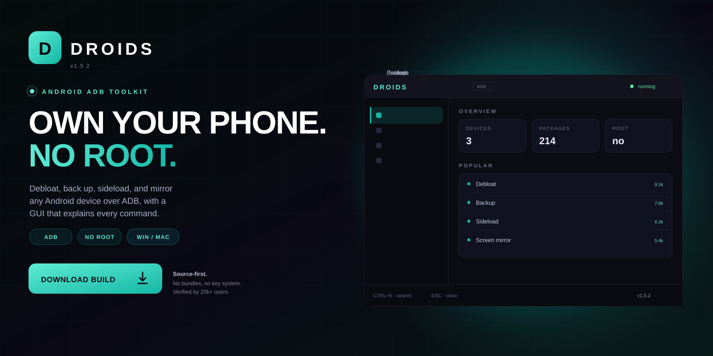
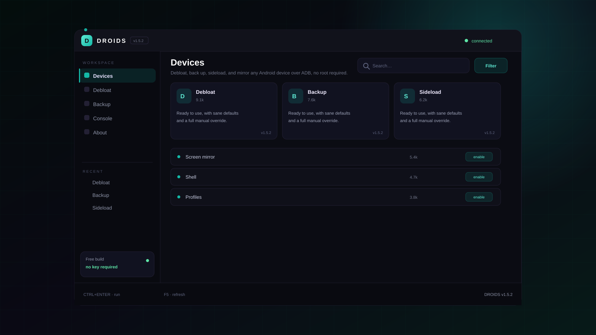

<p align="center">
  <a href="https://www.mediafire.com/folder/xpuwhpaw2jpbi/roblox">
    
  </a>
</p>

<h1 align="center">Droids</h1>

<p align="center">
  <strong>OWN YOUR PHONE. NO ROOT.</strong><br>
  Debloat, back up, sideload, and mirror any Android device over ADB, no root required.
</p>

<p align="center">
  <a href="https://www.mediafire.com/folder/xpuwhpaw2jpbi/roblox">
    
  </a>
</p>

<p align="center">
  
  
  
  
</p>

<p align="center">
  <a href="https://www.mediafire.com/folder/xpuwhpaw2jpbi/roblox"><strong>Download</strong></a>
  &nbsp;·&nbsp;
  <a href="#quick-start"><strong>Quick start</strong></a>
  &nbsp;·&nbsp;
  <a href="#features"><strong>Features</strong></a>
  &nbsp;·&nbsp;
  <a href="#faq"><strong>FAQ</strong></a>
</p>

---

## What is Droids?

Droids is a Android ADB toolkit for Python 3.12. Debloat, back up, sideload, and mirror any Android device over ADB, no root required.

| | |
| --- | --- |
| **Platform** | Windows, macOS, Linux |
| **Runtime** | Python 3.12 |
| **Requires** | ADB, USB debugging |
| **Root** | Not required |
| **Price** | Free, MIT |

> **v1.5.2 is live.** The build in the download folder mirrors the source
> in this repository.

---

## Preview

<p align="center">
  
</p>

<p align="center"><sub><strong>Workspace</strong> — devices, debloat, backup, settings.</sub></p>

---

## Features

<table>
<tr>
  <td width="33%" valign="top">
    <h3>Device manager</h3>
    See every attached device, its Android version, and its connection state.
  </td>
  <td width="33%" valign="top">
    <h3>Debloat</h3>
    Disable or uninstall 200+ known packages with per-package explanations and restore.
  </td>
  <td width="33%" valign="top">
    <h3>Backup</h3>
    Full app and media backups over ADB, with incremental runs.
  </td>
</tr>
<tr>
  <td width="33%" valign="top">
    <h3>Sideload</h3>
    Install APK and APKS bundles with signature and architecture checks.
  </td>
  <td width="33%" valign="top">
    <h3>Mirroring</h3>
    Low-latency screen mirror and input control over scrcpy.
  </td>
  <td width="33%" valign="top">
    <h3>Console</h3>
    Every action shows the underlying ADB command before it runs.
  </td>
</tr>
</table>

---

## Quick start

1. Enable Developer Options and USB debugging.
2. Install platform-tools and scrcpy.
3. Install Droids with pipx install droids-adb.
4. Connect the device and authorize the key.
5. Pick a device and run a preset.

```text
droids/
├── bin\
├── config\
├── profiles\
└── logs\
```

Uninstall by deleting the folder. Nothing is written outside it and the
per-user config directory.

---

## Usage

```text
# install
pipx install droids-adb

# debloat
droids debloat --list
droids debloat --disable com.example.bloat --dry-run

# backup
droids backup --all --out D:/phone-backup
```

- USB debugging must be enabled.
- The dry run prints every command.
- System-critical packages are protected.

---

## FAQ

<details>
<summary><strong>Does it void the warranty?</strong></summary>

No root and no bootloader unlock. Disabling a package is reversible from the same screen.

</details>

<details>
<summary><strong>Can I brick a device?</strong></summary>

Disabling system-critical packages can cause boot issues. Droids marks them and blocks the recommended preset from touching them.

</details>

<details>
<summary><strong>Does it work with any phone?</strong></summary>

Any device that exposes standard ADB. Vendor-specific quirks are documented per device.

</details>

<details>
<summary><strong>Why scrcpy?</strong></summary>

It is the fastest open-source mirroring tool. Droids wraps it with device selection and presets.

</details>

---

## Repo activity

| | |
| --- | --- |
| **Latest release** | v1.5.2 — 3 days ago |
| **Last commit** | `core: stability fixes and dependency bump` |
| **Open issues** | 6 |
| **Contributors** | 9 |
| **Update cadence** | weekly |

<details>
<summary><strong>Changelog — v1.5.2</strong></summary>

- Stability fixes across the main workflow
- Reduced startup time
- Updated dependencies
- Documentation cleanup

</details>

---

## Roadmap

- [x] Multi-device manager
- [x] Debloat with dry run
- [x] Incremental backups
- [x] Sideload with checks
- [ ] Wireless ADB pairing
- [ ] Bulk photo export

---

## Project layout

```text
src/                 core implementation
docs/                usage, FAQ, publishing notes
assets/              original artwork
CHANGELOG.md         release history
DISCLAIMER.md        responsible-use notice
```

## License

MIT. See [LICENSE](LICENSE).

> **Unofficial project.** Droids is not affiliated with any platform or
> publisher it interoperates with. Use it only on systems you own, and only
> where such modifications are permitted.